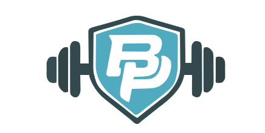
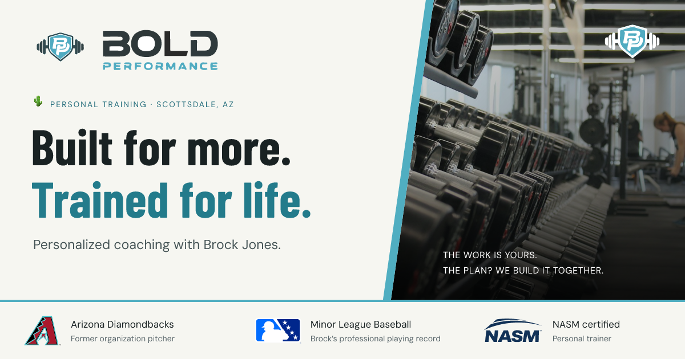

# <picture><source media="(prefers-color-scheme: dark)" srcset="public/assets/mark-dark.svg"></picture> Bold Performance



[](https://github.com/nicholasadamou/bold-performance/actions/workflows/ci.yml)


[](LICENSE)

Brock Jones’s personal training and performance coaching website in Scottsdale,
Arizona. Visitors can explore coaching services, use twenty training tools, and
prepare a detailed introduction. The intake creates an email draft or sends
through Formspree when configured.

[Visit Bold Performance](https://bold-performance.vercel.app)

## Getting started

```sh
flox activate
bun install --frozen-lockfile
bun run dev
```

## Documentation

- [Visitor guide](docs/visitor-guide.md): coaching pages, FAQs, and the intake form.
- [Getting started and local verification](docs/development.md): Flox, previews, and the shared quality gate.
- [Training tools](docs/tools.md): calculator behavior and planning guides.
- [Contact setup](docs/contact.md): email drafts and optional form delivery.
- [Brand assets and content](docs/content.md): logos, photography, and editing guidance.
- [Deployment](docs/deployment.md): Vercel hosting and automatic releases.

## Local verification

Run `./scripts/check.sh` inside Flox. It checks formatting, Markdown and Mermaid,
links, source budgets, types, unit tests, the production build, and workflow
syntax. The pre-commit hook and GitHub Actions run the same gate.

See [development](docs/development.md) for browser QA and preview commands.

## License

Copyright © 2026 Nicholas Adamou.

The project is licensed under [PolyForm Shield License 1.0.0](LICENSE).
